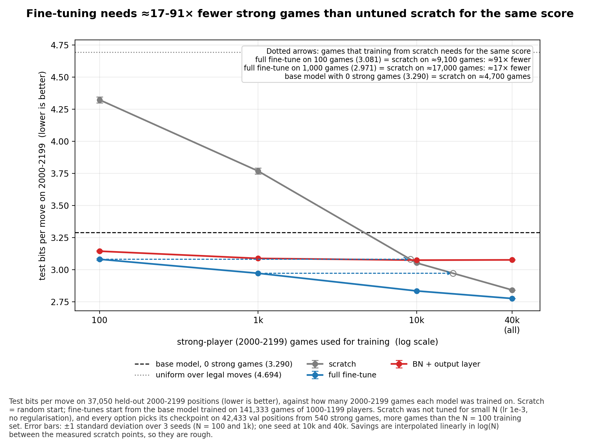

# Chess move prediction by rating

A small residual CNN that predicts the move a human player will make in a blitz game, trained on Lichess games of a given rating band. Predictions are scored in **bits per move**: the number of bits a compressor using the model would need to store the move that was played. The project then asks two questions:
- **Few games:** if only a few games of strong (2000–2199) players are available, how much does pretraining on weak (1000–1199) players help?
- **The rating input:** does the network learn what a rating means, and can one model trained on several rating bands at once predict the bands in between?

Built in October 2026 with PyTorch and python-chess, on open Lichess data (CC0). Most runs were trained on a laptop (Apple M1); the joint run was trained on a Windows desktop (GTX 1650 Super).



## Headline results

Test bits per move and top-1 accuracy, all on the same test rows (shard 000: 28,654 positions of 1000–1199 and 37,050 of 2000–2199, from 487 games each):

| Model | 1000–1199 | 2000–2199 |
|---|---|---|
| Base model, trained on 1000–1199 only | **2.831** / 41.3% | 3.290 / 33.4% |
| Base model + full fine-tune on all 40,019 games of 2000–2199 | 2.925 / 39.3% | **2.775** / 41.7% |
| One model trained on 4 other bands at once (no 2000–2199 games) | **2.751** / 42.5% | **2.750** / 41.8% |
| Uniform over legal moves | 4.604 / 6.9% | 4.694 / 5.9% |

- **The base model:** 459,145 weights, one pass over 141,333 games of 1000–1199 blitz. On all 849,649 test positions of its band it scores 2.830 bits and 41.5% top-1: **38.5% fewer bits** than knowing only the rules.
- **Pretraining on weak players saves strong-player games,** compared with training from scratch with the same settings (not tuned for small N). Fine-tuned on 100 strong-player games, the model matches scratch on roughly 9,100 (about 90× fewer). On 1,000 games, it matches scratch on roughly 17,000 (about 17×). At 10,000 games it is about as good as scratch on all 40,019. Across 3 random seeds, the fine-tunes vary by at most 0.011 bits (standard deviation at most 0.006).
- **Adjusting only the BatchNorm scale and shift plus the output layer (6,409 weights) is not enough at small N:** it levels off at about 3.1 bits. At 10,000 games and more its training diverged, so its limit there was not measured.
- **Models trained on one band, or on one band after another, prefer the ratings they were trained on,** whatever band they predict, as Maia's per-level models do.
- **One model trained on 4 bands at once** (1000–1199, 1400–1599, 1800–1999, 2200–2399, every batch mixing all four) behaves differently. The rating that predicts a band best now rises with the band's real rating, also for the three bands in between that it never saw. This is a small-scale version of the idea behind Maia-2. It also has lower test bits than every earlier model on every band they share. That comparison is not controlled, though: the joint model trained about 2× longer than the base model, it trained on the bands next to each never-seen band, and the bands share some players.

## Write-ups

1. [The base model](results/WriteUp1_BaseModel.md): data, model, training, results.
2. [Learning strong players from few games](results/WriteUp2_FewGames.md): scratch vs full fine-tune vs BN + output layer fine-tune, at 100 to 40,019 games, and forgetting.
3. [Every rating band, and what the rating input learned](results/WriteUp3_RatingBands.md): cross-band evaluation and a rating sweep.
4. [One model for every rating](results/WriteUp4_JointBands.md): one model trained on 4 bands at once, measured on 9 bands.

All numbers, tables and figures are collected in the results appendix [`results/RESULTS.md`](results/RESULTS.md), with [`tables.md`](results/tables.md) and the figures F1–F10 in [`results/figures/`](results/figures/).

## How it works

- **Input:** the board from the view of the player to move (mirrored when Black moves): 17 binary 8×8 planes for the pieces, castling rights and en passant, plus one plane holding the mover's rating, scaled to (Elo − 1500)/400.
- **Network:** a 3×3 stem, 6 residual blocks (64 channels, BatchNorm), and a 1×1 head.
- **Output:** a score for each of 4,168 move slots (64 from-squares × 64 to-squares, plus 72 underpromotions). Illegal moves are masked out, and the loss is cross-entropy in bits.
- **Data:** Lichess, September 2026 (the first 1.5 GB, about the first 1–2 days of the month). Blitz games only (Lichess's estimated duration of 3 to 8 minutes per player), both players inside the rating band, split 80/10/10 **by game**.

## Running it

**Requirements:** Python 3.9+, `python-chess`, `numpy`, `torch`, `pandas`, `matplotlib`, and `zstd` on the command line. About 20 GB of free disk space.

```bash
# 1. Download the first 1.5 GB of the September 2026 Lichess file (4.6M games)
mkdir -p data/raw
curl -r 0-1499999999 -o data/raw/lichess_2026-09_first1500MB.pgn.zst \
     https://database.lichess.org/standard/lichess_db_standard_rated_2026-09.pgn.zst

# 2. Extract the rating bands (≈10 min), then encode each band into .npz shards (≈30 min for 1000-1199)
zstd -dc data/raw/lichess_2026-09_first1500MB.pgn.zst | python3 extract_games.py data/games_uci
for b in 1000-1199 2000-2199 1200-1399 1400-1599 1600-1799 1800-1999; do
    python3 encode.py lichess_2026-09_elo${b}_blitz
done

# 3. Train the base model (one pass, ≈28 min on an M1 GPU), measure it once on all test rows,
#    and keep that measurement as the base model's test result
python3 train.py --data 1000-1199 --init scratch --epochs 1 --eval-every 500 --also 2000-2199 --out base
python3 train.py --eval-only --init runs/base/best.pt --data 1000-1199 --also 2000-2199 --test --test-shards 99 --out base_test
cp runs/base_test/test.json runs/base/test.json

# 4. The few-games experiment: 24 runs, ≈4.5 h
bash experiments.sh

# 5. Cross-band evaluation and rating sweep (≈15 min)
python3 eval_bands.py

# 6. The joint run: one model on 4 bands (≈31 min on a GTX 1650 Super). It unpacks joint_games.tar.gz
#    (made with: zstd -dc ... | python3 extract_games.py data/games_uci_joint joint) into data/joint/,
#    so it never touches the data of steps 2-5
python3 run_joint.py

# 7. Collect results, tables and figures
python3 collect_results.py && python3 summarize.py && python3 figures.py
```

`python3 train.py --help` lists every option, and `python3 plot.py runs/<name>` shows a run's training curves live while it trains.

**Note:** the base model in `runs/base/` was trained with an intermediate version of `train.py` that was never committed (its `config.json` has no `test_shards` field). The command in step 3 is the equivalent with the current `train.py`.

## Files

| File | What it does |
|---|---|
| `extract_games.py` | Lichess PGN → one text file of UCI moves per band, with ratings |
| `encode.py` | games → board planes, legal moves, played move, rating; saved as `.npz` shards and checked |
| `train.py` | network, batches (one band, or several bands mixed in every batch), training loop with early stopping, evaluation and test |
| `experiments.sh` | runs the 24 runs of the few-games experiment |
| `eval_bands.py` | measures saved models on every band, and runs the rating sweep |
| `run_joint.py` | the whole joint run on one machine: unpack, encode, train, measure |
| `collect_results.py` | `runs/` → `results/*.csv` |
| `summarize.py`, `figures.py`, `plot.py` | tables, summary figures, per-run training curves |
| `runs/<name>/` | one folder per run: `config.json`, `history.json`, `test.json`, `training_curves.png` (weights are not in git) |
| `results/` | the results appendix, the write-ups, the CSV files, the tables and the figures |

The `data/` folder and the model weights (`*.pt`) are not in the repository. Steps 1–6 recreate them.

## Related work

- **Maia** (McIlroy-Young, Sen, Kleinberg & Anderson, KDD 2020) trains one model per rating level and predicts human moves with over 50% top-1 accuracy, using much larger models and data. It also finds that each per-level model predicts best near its own training rating, as write-up 3 does here. Its numbers are measured differently (it skips the first 10 plies and moves made in time trouble, and tests on a later month), so they are not directly comparable.
- **Maia-2** (Tang et al., NeurIPS 2024) trains one model across all skill levels, with both players' ratings as input, and shows that it is more coherent across levels than per-level models. Write-up 4 is a small-scale version of that idea with a single rating plane.
- **Meta-transfer learning** (Sun, Liu, Chua & Schiele, CVPR 2019) loosely inspired the BN + output layer option. That work meta-learns a scaling and shifting for each neuron; the option here is plain gradient descent on BatchNorm's scale and shift and the output layer.
- **Generalized few-shot learning** (Kukleva, Kuehne & Schiele, ICCV 2021) is related to measuring the old and the new bands together.

